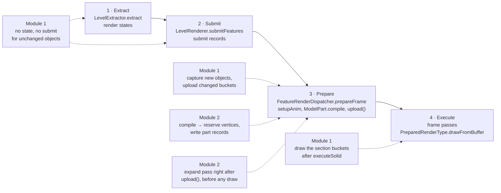

# Architecture

How Mobium works as of 0.2.0 (Minecraft 26.3, Fabric/Quilt and NeoForge). Every vanilla, Sodium, Iris and EMF detail
below is documented with its class and method in `docs/vanilla-notes.md`; what is planned next is in `PLAN.md`.

**The one rule:** Mobium may change *how* geometry reaches the GPU, never *what* ends up on screen. Every module
switches between Mobium's path and vanilla's, never between two pictures.

## What Mobium does

| Module | What it does | Package | State in 0.2.0 |
| --- | --- | --- | --- |
| 1 · Static cache | Block entities and entities that stand still are captured once through vanilla's own submit and prepare and drawn from per-section GPU buffers until they change | `cache/` | On by default |
| 2 · GPU part transform | Model parts are posed on the CPU as before (`setupAnim`, EMF), but the GPU writes their vertices, byte for byte what the CPU would have written | `parts/` | On by default where the GPU has OpenGL 4.3 compute with double precision |
| 3 · Animation LOD | Far or tiny-on-screen mobs reuse last frame's pose | — | Not built; its config and settings exist (`PLAN.md`) |

Both modules need the OpenGL backend in 0.2.0; on Minecraft's Vulkan backend they stay off (`PLAN.md`, *M7*).

- **Must-have compatibility:** Iris shader packs, and EMF/ETF including Fresh Animations. Never bypass `setupAnim`.
- **Coexists with:** Sodium 0.9, Entity Culling, Mod Menu. Mods that do the same job (Enhanced Block Entities,
  Vanillate, Accelerated Rendering) switch off the module they overlap (`docs/compat.md`).
- **Non-goals:** game logic (Mobium is client-only), terrain (Sodium's job), occlusion culling (Entity Culling's),
  hiding or capping entities, shader packs that need patching.

## The frame Mobium plugs into

26.3 renders world objects in four stages (`docs/vanilla-notes.md` §0). Posing and writing vertices are one stage,
*prepare*, and every vertex of the frame ends up in one shared `StagedVertexBuffer` that is uploaded once.



The same stages run for the hand, the GUI, picture-in-picture and Iris's shadow pass, each with its own staged
buffer; Module 2 works in all of them, Module 1 draws only in the level's main pass.

The GPU layer is Renderpearl (`com.mojang.renderpearl`: `api`, `frontend`, `backend` with `opengl` and `vulkan`).
OpenGL is 26.3's default, Vulkan opt-in; 26.4 makes Vulkan the default (`docs/vanilla-notes.md` §5, §18).

## Module 1: static cache

**What is cached** (`cache/CachePolicy.kt` for block entities, `cache/EntityPolicy.kt` for entities; every row has its
own switch):

| Object | Cached while | Vanilla while |
| --- | --- | --- |
| Chests (also trapped, copper, ender), shulker boxes | Closed | Opening, open, closing (+1 frame) |
| Signs and hanging signs, with text and glow ink | Always | Being edited; obfuscated, sprite or player-head text |
| Skulls and heads, decorated pots | Always | Pot wobbling; dragon head powered; player heads with an owner |
| Shelves and their items | Every item draws the same as at capture | An item is animated (a spinning compass) |
| Item frames, glow item frames | Item and rotation unchanged | A map in it; name tag, glowing, leash |
| Armor stands | Pose unchanged, no armor | Wobbling, hurt, armor, an owned player head |
| Item and block displays | `FIXED` billboard, interpolation finished | Moving or interpolating; other billboards |

Models EMF animates stay vanilla. Banners, bells, conduits and lecterns animate every frame; Module 2 takes them.
Beds have no block entity in 26.3 (they are terrain).

**How it works** (`cache/StaticCache.kt`):

1. **Skip.** For an unchanged cached block entity, `BlockEntityRenderDispatcher.tryExtractRenderState` returns no
   state, whether vanilla's or Sodium's block entity loop asks; in Iris's shadow pass, which extracts again, and with
   the breaking overlay on it, the object is extracted and drawn by vanilla. Entities are always extracted
   (render states have no "unchanged" signal): the hook inside `EntityRenderDispatcher.submit` compares the fresh
   state with the captured one (position exactly, light, and per rule its inputs: `ItemFingerprint`,
   `BlockModelFingerprint`) and skips the renderer's submit while they match. Flames and shadows stay vanilla. The
   cache entry lives on the block entity or entity itself (`BlockEntityMixin`, `EntityMixin`), so the per-frame check
   needs no map lookup.
2. **Capture.** A new or changed object is drawn by vanilla in the frame it is seen and captured right after the
   level's prepare (`cache/Capture.kt`): its renderer submits into a private `SubmitNodeStorage` and vanilla's own
   feature renderers write into `CaptureConsumer`, so resource packs, EMF/ETF and Iris's entity ids apply as drawn.
   Vertices are kept in the vertex format active at capture, Iris's extended formats while a shader pack is on.
   Only what vanilla draws in the level's **solid** phase is accepted (models, block models, solid item quads,
   opaque sign text); anything translucent, the crumbling overlay, custom geometry or glint fails the capture and the
   object stays vanilla. On Fabric, block models arrive as the renderer API's `ExtendedBlockModelSubmit`, which the
   capture lets Sodium's or Indigo's feature renderer write.
3. **Bucket.** Captured meshes are concatenated per (chunk section, render type) in a `SectionBucket`. The CPU keeps
   section-local vertices and writes camera-relative ones into the bucket's GPU buffer when the camera moved or a
   member changed (vanilla's entity and text shaders take the fog distance from the raw position, so an offset in
   the model-view matrix would change the fog; `docs/vanilla-notes.md` §15). With a still camera nothing is uploaded.
4. **Draw.** After the level pass's `PreparedFrame.executeSolid`, each visible bucket is drawn with
   `PreparedRenderType.drawFromBuffer` through `Gpu.backend` (`gpu/RenderpearlBackend.kt`): vanilla's pipeline and
   shaders, Iris's replacements included. No shader is changed.
5. **Invalidate.** Each rule's inputs are compared every frame (sign text, pot sherds, skull owner, items); block
   state by identity; light through `LightStamps` (the light epoch of each section's last update, so an update
   elsewhere costs one or two lookups per object); resource reload, level change and render distance through
   `LevelExtractor.allChanged` / `setLevel`; a shader pack switch through Iris's pipeline identity; removed block
   entities through `BlockEntity.setRemoved`.
6. **Budget.** The cached vertex data (once on the GPU, once in system memory) is limited to `cache.memoryBudgetMb`
   (default 128, 16–1024 MB); above it the farthest objects are evicted and stay vanilla until usage is below 75 %
   (`cache/MemoryBudget.kt`).

Iris's shadow pass draws cached objects through vanilla (the cache leaves that pass alone).

## Module 2: GPU part transform

A model part keeps every CPU step up to its own `compile`: `setupAnim`, EMF's animations (evaluated inside
`ModelPart.render`), the part walk and its pose math, per-part texture overrides, ETF's emissive passes. Only
`compile`, which transforms each cube's corners and writes them vertex by vertex, is replaced
(`parts/PartTransform.kt`).

1. **Hooks.** `ModelPartMixin` wraps vanilla's `ModelPart.compile`; `compat.emf.EmfModelPartMixin` wraps EMF's
   override, which Fresh Animations' parts use. A part is taken when the consumer is a builder the frame's staged
   buffer opened (directly or through an atlas sprite), its draw is unsorted, its format is the entity format or
   Iris's 56-byte one, and every cube is a vanilla cube or EMF's `EMFCube`. Otherwise, and for entity types in
   `parts.excludedEntities`, vanilla compiles.
2. **Three cube paths.** A vanilla cube is written as vanilla writes it, or, with Sodium installed, as Sodium's
   `ModelCuboid` path writes it (corners by a chain of additions, its own face order; `parts/SodiumCubes.kt`); EMF's
   cubes are written as EMF writes them. Module 2 reproduces whichever path would have drawn the part.
3. **Meshes.** The first time a cube is drawn, its faces are written once in the cube's local space, in the layout of
   that path (`parts/MeshPool.kt`); the mesh is kept on the cube object, so EMF's cubes work too, and written again
   after a reload.
4. **Reserve and record.** Instead of writing vertices, `compile` reserves their bytes in the staged builder (leaving
   Iris's per-vertex state as after a Sodium push) and writes one 128-byte part record (pose, normal matrix or packed
   normals, colour, overlay, light, flags, draw slot, sprite, Iris's three entity ids) and one 16-byte record per cube
   into the staged buffer's `PartBatch` (off-heap, per frame).
5. **Upload.** `StagedVertexBuffer.upload()` lays out the draws and copies them to the GPU as usual, except that the
   reserved ranges are left out of the copy into the staging buffer (`parts/ReservedRanges.kt`).
6. **Expand.** Right after `upload()` and before anything is drawn from it, `parts/ExpandPass.kt` uploads new meshes
   and the frame's records and runs `assets/mobium/shaders/expand_parts.comp` once per quad, writing the reserved
   vertices into the vertex buffer vanilla just filled, followed by a vertex-attribute barrier. Vanilla's own draws
   then draw them, in vanilla's order. The pass is raw OpenGL 4.3 on the buffers' GL names (`gpu/gl/GlCompute.kt`),
   because Renderpearl has no compute or storage buffers.
7. **Two stages, same bytes.** Mesa's iris records a compute dispatch in a batch of its own and flushes both batches
   around it, a fixed GPU cost per frame however few parts there are. So without a shader pack the same shader runs
   compiled as a vertex shader, drawn as points with rasterisation off (the *vertex stage*, where vertex shaders may
   write three storage buffers); with a shader pack it stays a compute dispatch, whose early flushes help a GPU-heavy
   frame. `ExpandPass.stage` chooses; `-Dmobium.parts.stage=compute|vertex` overrides (`docs/benchmarks.md`,
   *Module 2's fixed cost*).

**Exactness.** The shader repeats the Java code's float operations in their order (`precise`, JOML without fused
multiply-adds, Sodium's and Iris's own formulas), corrects square roots and divisions to the correctly rounded float
with exact double residuals (GPUs do not round them correctly; Mesa on the Arc 140V was off in 24k of 3.3M normals),
and writes Iris's per-quad extension (face normal, mid UV, tangent) as Iris does on the CPU (`docs/vanilla-notes.md`
§16).

**Checks.** The CPU path is the reference. `parts/PartValidation.kt` compiles parts on the CPU as well, reads the
GPU's vertices back and compares them byte for byte (bytes the CPU never writes left out):

- every part in the dev validation (self-check `--mode parts`, the Fabric gametests on Mesa's software renderer);
- on players' GPUs, the first 64 parts of each shader path, at most 8 per frame (`parts/PartCheck.kt`,
  `parts/PathSampler.kt`). On a difference the compared parts get the CPU's bytes in that frame and Module 2 switches
  off until restart, with one toast and the GPU named in the log. F3 `mobium:modules` shows the parts compared.

**Not taken:** translucent models without improved transparency (sorted on upload, which reads the CPU's vertices),
glint, outline and the breaking overlay (other formats or consumers), other cube classes and vertex formats.

## Core

- **Module states** (`core/ModuleState.kt`, `core/ModuleStates.kt`). The pure, unit-tested `ModuleRules` resolve each
  module from the config, the A/B key, overlapping mods, failures, the backend and compute support, with one
  `OffReason` when it is off (`failed`, `global_switch`, `ab_toggle`, `config`, `overlap`, `backend`, `no_compute`,
  `not_built`). `ModuleStates` re-resolves on every change and logs each transition; modules ask `isActive()` per frame.
- **Fallback ladder** (`core/Fallback.kt`). Per submit: anything unknown (a wrapped consumer, another format, a cube
  class Mobium does not know) takes vanilla's path. Per type: a type that fails 3 times stays vanilla. Per module: an
  exception or GPU error switches the module off for the session, with one log line and one toast. The pure
  bookkeeping (`FailureLedger`) is unit-tested.
- **Capabilities** (`core/Capabilities.kt`): the backend from `DeviceInfo.backendName()`, OpenGL compute with double
  precision, whether vertex shaders may write storage buffers, multi-draw indirect. Logged at startup.
- **Compat** (`core/Compat.kt`, `IrisCompat.kt`, `EmfCompat.kt`): which compat mods are loaded, Iris's shader pack and
  vertex formats, EMF's animated roots, overlapping mods. Compat mixins (`mixins/compat/`) apply only when their mod
  is present (`MobiumMixinPlugin`) and are optional where they only measure.
- **Threads.** Everything runs on the render thread; Mobium starts no threads.

## GPU layer

`gpu/GpuBackend.kt` is what the modules need from the GPU: buffers, uploads, fences, and drawing a buffer range with a
vanilla render type. `gpu/RenderpearlBackend.kt` implements it on Renderpearl, which covers OpenGL and Vulkan alike,
and counts Mobium's GPU memory for F3. Compute has no Renderpearl API: Module 2's expand pass uses raw OpenGL 4.3
(`gpu/gl/GlCompute.kt`) on Renderpearl's `GlBuffer.handle()`. `gpu/RingBuffer.kt` (frames in flight with fences) and
its unit-tested arithmetic `RingAllocator.kt` are not used by 0.2.0; on OpenGL the expand pass orphans its record
buffer instead.

## Debug and measurement

- **A/B key** (`debug/AbToggle.kt`): switches all of Mobium off and on live without touching the settings. A physical
  key position (SDL scancode, right of P).
- **F3 entries:** `mobium:modules` (`debug/ModuleLines.kt`: states and reasons, GPU memory, cached objects, the GPU
  check, failed types) and `mobium:timings` (`debug/DebugLines.kt`: the `debug/Sections.kt` timers around extract,
  submit, pose, tessellate, prepare and draw, and Iris's shadow pass, averaged over 64 frames).
- **Benchmarks** (`bench/`): `/mobium bench`, `suite`, the gate commands, `stages`, the players' `/mobium benchmark`
  with its built-in data pack, and the unattended rounds (`BenchAutorun`). Protocol and results in
  `docs/benchmarks.md`.
- **Dev only:** `debug/Validation.kt` (`/mobium debug validate`: a frame with Mobium against the next with vanilla,
  pixel by pixel), `/mobium debug fail <module>`, `/mobium debug gpucheck`, `debug/ExpandProfile.kt` (CPU time and
  Renderpearl's GPU timestamps of the expand pass, on both backends), `debug/VulkanValidation.kt` (a debug messenger
  of Mobium's own on Vulkan with the validation layer, which sorts out the messages Mobium's objects or calls raise)
  and `debug/selfcheck/` (the in-game self-check that `benchmark/self_check.py` drives, `--api opengl` or `vulkan`).

## Config and settings

`config/mobium.json` through konfig, `{"version", "config"}`, format version 4 (`config/ConfigHandler.kt`: a format
change bumps `CONFIG_VERSION` and adds a migration branch; unknown keys keep failing). Contents (`config/Config.kt`):
the global switch; Module 1's switch, memory budget and eight type switches; Module 2's switch and excluded entity
types; Module 3's preset (Off, Subtle, Aggressive) and exclusions. One settings screen built from vanilla's option
widgets (`config/screen/MobiumSettingsScreen.kt`) edits a copy and applies it on Done; it opens from Mod Menu
(Fabric), the NeoForge mod list, and Mobium's page in Sodium's video settings (`config/SodiumOptions.kt`, Sodium
Config API). `en_us` and `de_de` keep identical keys (`LangKeysTest`).

## Package map

```
dev.nyon.mobium
├── MobiumEntrypoint.kt, Mobium.kt, MobiumKeys.kt   # loader entrypoints (Stonecutter), bootstrap, key bindings
├── bench/        # /mobium bench, suite, gates, stages, benchmark; FrameRecorder, BenchPack, BenchAutorun, GateB/GateC
├── cache/        # Module 1: StaticCache, Capture, CaptureConsumer, SectionBucket, Cache/EntityPolicy, fingerprints,
│                 #   LightStamps, MemoryBudget, CachedBlockEntity/CachedEntity, ExtendedSubmits (Fabric renderer API)
├── config/       # Config, ConfigHandler, settings screen, ModMenuImpl, SodiumOptions
├── core/         # ModuleState (rules), ModuleStates, Fallback, Capabilities, Compat, IrisCompat, EmfCompat
├── debug/        # AbToggle, F3 entries, Sections, Validation, ExpandProfile, VulkanValidation, selfcheck/
├── gpu/          # GpuBackend, RenderpearlBackend, RingBuffer + RingAllocator (unused), gl/GlCompute
└── parts/        # Module 2: PartTransform, PartHooks, MeshPool, SodiumCubes, PartBatch, ReservedRanges, ExpandPass,
                  #   PartValidation, PartCheck, PathSampler
```

Mixins live in `src/main/java/dev/nyon/mobium/mixins` (compat mixins in `compat/emf` and `compat/iris`), shaders in
`src/main/resources/assets/mobium/shaders`, unit tests (pure Kotlin) in `src/test`, Fabric client gametests in
`src/gametest`. The hook table is `docs/vanilla-notes.md` §10.

## Design decisions

| Decision | Why |
| --- | --- |
| Capture through vanilla's own submit and prepare instead of building meshes | Resource packs, EMF/ETF and Iris's formats and ids are right by construction; nothing downstream has to know Mobium exists |
| Draw through `PreparedRenderType.drawFromBuffer`, never Mobium's own shaders | Vanilla's pipelines and Iris's replacements stay in charge of what is drawn |
| One bucket per (section, render type), camera-relative vertices written by the CPU | A per-object offset would need a shader change Iris packs do not expect; an offset in the model-view matrix changes the fog |
| Module 2 replaces `ModelPart.compile`, not the part walk | EMF overrides `render` and `compile` and animates inside `render`; Sodium's cube path sits below `compile` |
| Expand into vanilla's own uploaded vertex buffer | Vanilla's draw order and sorting stay untouched, and no draw call is added |
| The CPU path is the reference, compared byte for byte | A Kotlin copy of the shader's math would only test the copy; the 24k wrong normals on the Arc 140V were found this way |
| Gates measure what Mobium can change | Gate B and Gate C were redefined when the first targets turned out to depend on GPU work vanilla pays as well (`docs/benchmarks.md`, *Gates*) |
| Vanilla first | Every feature has a config switch, a per-type switch and a runtime fallback; new hooks ship off until their screenshot tests pass |

## Project

| Topic | Value |
| --- | --- |
| Name, mod id | Mobium, `mobium` (mod id `mobium-test` for the gametests) |
| Maven group, package | `dev.nyon`, `dev.nyon.mobium` (mixins in `dev.nyon.mobium.mixins`) |
| Author, repository | `btwonion`, `btwonion/mobium`; Modrinth `mobium`, CurseForge `mobium-perf` |
| License | GPL-3.0 |
| Loaders | Fabric (and Quilt) and NeoForge from one source tree (Stonecutter, modstitch); client only |
| Targets | `26.3-fabric`, `26.3-neoforge` (`settings.gradle.kts`) |
| Languages | Kotlin for all logic, Java for mixins; Java 25 |
| Config | konfig, `config/mobium.json` |
| Translations | `en_us.json`, `de_de.json` with identical keys |
| House structure | `btwonion/autodrop`, `btwonion/better-boat-movement` |
